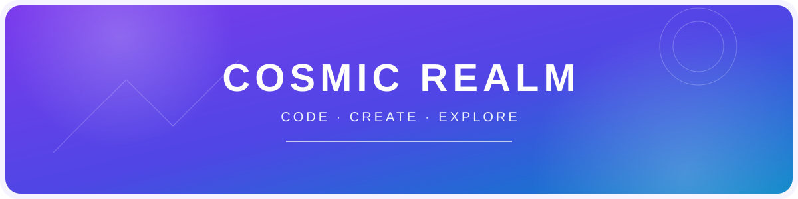

<!--
  COSMIC REALM — GitHub profile README
  Theme: adaptive neon gradients for light and dark GitHub themes.
-->

  <picture>
    <source media="(prefers-color-scheme: dark)" srcset="assets/hero-dark.svg">
    
  </picture>

  <h1>Hi, I'm Cosmic Dev 👋</h1>
  <h3>Full-Stack Developer | Java, React &amp; AI Engineering</h3>
  

    Building modern web applications and AI-powered solutions. 
    Exploring RAG, intelligent agents, Agentic AI and cloud-native technologies.
  

---

## ✦ About Me

- 💻 Full-stack developer working across Java, React and modern web technologies.
- 🧠 Exploring AI engineering — LLMs, RAG, vector databases and intelligent agents.
- ☁️ Growing my skills in DevOps, cloud-native tools and automation.
- 🚀 I enjoy turning practical problems into useful, reliable applications.

## ✧ Technology Universe

  <picture>
    <source media="(prefers-color-scheme: dark)" srcset="assets/tech-stack-dark.svg">
    
  </picture>

### Frontend

### Backend

### Databases

### DevOps & Tools

### AI Engineering · Currently Exploring

## 🚀 Featured Projects

  <picture>
    <source media="(prefers-color-scheme: dark)" srcset="assets/projects-dark.svg">
    
  </picture>

| Project | Overview | Technologies |
|---|---|---|
| **Scrum Master CRM** | CRM and sprint-management application for a SaaS company. | Java · React |
| **Document Reading App** | Application for reading and working with digital documents. | Java · React |
| **Store Transaction Management** | Application for managing store transactions. | Java · React |
| **Third-Party API Integration** | External API integrations with scheduled triggers and execution. | Java · React · APIs |

## 📊 GitHub Analytics

  
  

  

## 🌌 Contribution Galaxy

  <picture>
    <source media="(prefers-color-scheme: dark)" srcset="https://raw.githubusercontent.com/cosmic-realm/cosmic-realm/output/github-contribution-grid-snake-dark.svg">
    
  </picture>

## ✨ Let's Connect

  
    
  <picture>
    <source media="(prefers-color-scheme: dark)" srcset="assets/connect-dark.svg">
    
  </picture>

  ✨ Keep building. Keep exploring. The universe is yours to create. ✨

